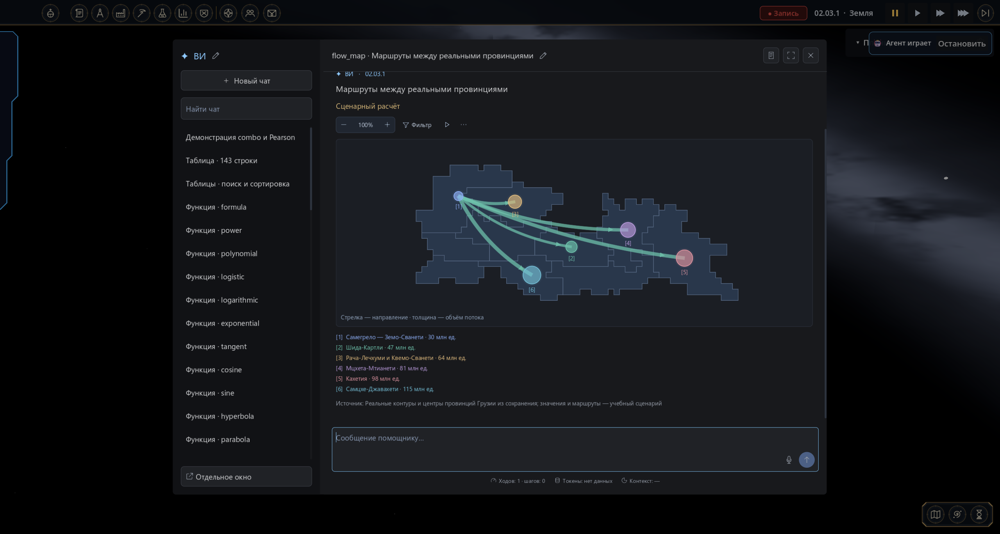

# Pax Harness

Ваш игровой помощник в отдельном удобном чате: обсуждайте планы, изучайте экономику, сравнивайте данные и стройте диаграммы прямо в **Pax Universe**.

Harness использует ИИ из настроек игры. Вы выбираете модель и подключение привычным способом, а мод добавляет переписку, инструменты и наглядные ответы.

## Что умеет

Свои параметры находятся на вкладке **Настройки → Харнес**: имя агента, ширина списка чатов и workflow изображений. Настройки API и модели остаются в штатной тонкой настройке игры.

- Несколько чатов, разделы, закрепление и поиск. Названия можно менять, а ширину списка — подстроить мышью.
- Ответы появляются постепенно. Вызовы инструментов можно раскрыть и посмотреть, откуда взялись данные.
- Таблицы с поиском, сортировкой, страницами и выгрузкой в CSV.
- Открытие игровых панелей по просьбе: ресурсы, производство, наука, настройки и другие доступные окна.
- Создание иллюстраций через настроенный в игре генератор изображений с показом результата прямо в чате.
- Снимок игрового окна для модели с поддержкой изображений: включается отдельно в «Тонкой настройке ИИ».
- 39 видов графиков и диаграмм, карты провинций и графики математических функций.
- Постоянные инструкции для одного чата или всей партии, план задачи с отметками прогресса.
- Ссылки на другие чаты через `@` и перетаскивание. По вашей просьбе помощник может прочитать связанный чат.
- Переписка, черновики и настройки чатов сохраняются с партией. Длинные разговоры можно продолжать благодаря сжатию истории.
- Данные совместимых модов: например, предприятия Pax Corporations, экономика и Сфера Дайсона. Доступные сведения зависят от установленных и включённых модов.

## Установка

Версия мода: **1.11.0**. Проверенная версия игры: **0.31.4**.

### Через официальную мастерскую

1. В лаунчере откройте **Мастерская**, найдите **Pax Harness** и нажмите **«Установить»**.
2. В разделе **Моды** убедитесь, что Pax Harness включён.

### Вручную из GitHub

1. Скачайте `pax_harness-1.11.0.zip` из раздела **Releases** и закройте игру.
2. Откройте **Лаунчер → Моды → Папка модов** и поместите туда ZIP целиком. Распаковывать архив не нужно. На Windows пользовательская папка обычно находится в `%APPDATA%\Pax Universe\mods`.
3. Запустите игру и включите Pax Harness в разделе **Моды**.

Если игра попросит разрешить выполнение кода мода, подтвердите его штатным способом. Подключите разговорную модель в настройках игры, загрузите или начните партию и откройте **ВИ** обычной игровой кнопкой.

Не устанавливайте одновременно архив и распакованную копию одного мода. При ручном обновлении замените старый архив или папку при закрытой игре. Установка из мастерской обновляется через лаунчер. Чаты хранятся в сохранении партии, а не в архиве мода.

## С чего начать

Напишите обычную задачу. Не нужно выбирать диаграмму вручную или составлять запрос на специальном языке.

> Сравни производство и потребление еды. Покажи дефицит и объясни, что ограничивает рост.

> Найди последние десять проваленных планов и сгруппируй причины.

> Сравни предприятия по отраслям: количество, выручка и прибыль. Покажи таблицу и диаграмму.

> Построй график запасов стройматериалов по сохранённой истории. Отдельно отметь, где данных не хватает.

> Покажи на карте провинции с наибольшим числом предприятий.

> Составь план развития энергетики. Сначала только анализ, без изменений в игре.

Для расчётного примера можно попросить: «Покажи, как будет меняться спрос при ежегодном росте на 5 %» или «Нарисуй параболу и синусоиду». Такой расчёт помечается отдельно от наблюдаемых игровых данных.

## Графики и таблицы

| Для чего | Что можно показать |
| --- | --- |
| Сравнение | Горизонтальные и вертикальные столбцы, составные столбцы, водопад, парные сравнения dumbbell |
| Изменения во времени | Линии, площади и составные площади, столбцы вместе с линией, slope и bump |
| Доли и иерархии | Круговая и кольцевая диаграммы, treemap, sunburst, дерево, icicle |
| Связи показателей | Точки, пузырьки, радар, параллельные координаты, набор небольших графиков |
| Распределения | Гистограмма, box plot, плотность, violin и ridgeline |
| Матрицы и интервалы | Тепловая и календарная карты, интервальные полосы, границы значений error bar |
| География | Хороплет, схематичная картограмма, символы на карте и карта потоков |
| Потоки и проекты | Санки, сеть связей и диаграмма Ганта |

Наведите мышь на точку, область или поток, чтобы увидеть подробности. У диаграмм есть масштабирование, фильтры и повтор анимации. В Санки и сетях можно подсветить связанные потоки; в sunburst — раскрывать ветви. Таблицы позволяют находить строки, сортировать столбцы и сохранять CSV.

Помощник использует доступные источники и сохранённую историю. Сведения, которых нет в партии, не возникают задним числом: попросите указать период и охват, если сравнение должно быть точным. Для модов доступность конкретной карты или показателя зависит от того, какие данные предоставляет сам мод.

## Экран, панели и изображения

Попросите: «Открой ресурсы», «Открой настройки нейросети» или «Посмотри на игровой экран». Помощник выбирает из доступных игровых окон. Снимки доступны, когда для выбранного адреса API и модели включены **«Использовать профиль»** и **«Изображения на вход»** в дополнительном моде «Тонкая настройка ИИ». Нужна модель, которая действительно принимает изображения. Снимается игровое окно; чат временно скрывается. Снимок передаётся следующему запросу и не записывается в сохранение.

Для иллюстраций настройте **Настройки → Нейросеть → Генерация фото**, затем попросите: «Сгенерируй иллюстрацию нашей будущей столицы». Генератор изображений работает отдельно от разговорной модели. Готовая картинка появляется в чате и сохраняется модом. Если подключение не настроено, помощник сообщит об этом.

Значок изображения в заголовке чата открывает параметры генерации. Обычно используется штатный генератор игры. Для ComfyUI можно вставить свой **API JSON workflow**, выбрать поле положительного описания и включить его. Адрес ComfyUI берётся из подключения игры. Harness меняет только выбранное поле описания; модели, размеры, seed и референсы задаются самим workflow. «Штатный генератор» отключает это переопределение.

## Инструкции и организация чатов

Значок инструкций находится справа вверху окна. Во вкладке **«Этот чат»** задайте пожелания для текущего разговора, во вкладке **«Вся партия»** — общие правила. Например:

> Отвечай по-русски и кратко. Всегда указывай единицы и дату данных. Перед изменением политики сначала объясни последствия.

Карандаш возле названия меняет имя чата, карандаш возле «ВИ» — имя помощника. Другие действия с чатом открываются правой кнопкой мыши. Чтобы связать разговоры, введите `@` в сообщении или перетащите чат из списка.

Если разговор стал длинным, можно отправить `/compact`. Сводка раскрывается в переписке; полный разговор остаётся в архиве. Сохранённый план можно продолжить просьбой «Продолжи план».

## Модели и совместимость

Модель выбирается **в настройках Pax Universe**. У Harness нет собственного списка аккаунтов и обязательного провайдера. Для работы нужна разговорная модель с API, поддерживаемым игрой. Качество рассуждений, скорость и способность пользоваться инструментами зависят от выбранной модели.

**Pax Prompt Lab необязателен.** Если он установлен, выбранные в лаборатории промпты и наборы инструментов могут использоваться в чатах Harness. Дополнительный мод **«Тонкая настройка ИИ»** позволяет настроить профиль подключённой модели.

Некоторые игровые моды отключают ИИ целиком. Например, у «Переработки экономики» есть собственная настройка доступности ИИ: если чат сообщает об отключении, проверьте её в настройках этого мода.

## Сохранения

Чаты, разделы, черновики, ссылки, инструкции и планы привязаны к партии. После загрузки можно продолжить разговор с того места, где остановились. Прерванный при выходе запрос не выполняется повторно сам по себе.

Помощник может использовать игровые инструменты, поэтому уточняйте желаемый режим: «только проанализируй», «предложи варианты» или «выполни». Сохранение перед крупными изменениями поможет сравнить результат с прежним состоянием партии.

## Галерея

Ниже — интерфейс в самой игре. Значения на трёх снимках с графиками и таблицей учебные; карта использует настоящие контуры провинций.

**Производство и потребление на общей диаграмме**

**Маршруты между провинциями**

**Поиск по большой таблице**

**Иллюстрация через подключённый генератор**

Изображение создано FLUX в подключённом ComfyUI. Это иллюстрация, а не наблюдение состояния партии.

## Авторы и лицензии

**Jemov** — Pax Harness и его развитие для Pax Universe.

В моде использованы адаптированные компоненты **Pax Prompt Lab**, автор **IliaOknesavi**: [исходный проект](https://github.com/IliaOknesavi/pax-prompt-lab-laboratoriya-promptov).

Визуальный и архитектурный референс — **DeepSeek Harness**: [исходный проект](https://github.com/deepseek-ai/deepseek-harness). Его лицензия MIT сохранена в [HARNESS_LICENSE.txt](HARNESS_LICENSE.txt). Авторские уведомления исходных компонентов сохранены в файлах мода.

## Структура проекта

- `src/chat` — переписка, история и сжатие контекста.
- `src/runtime` — выполнение задач и зарегистрированные инструменты.
- `src/transport` — подключение моделей и передача ответов и изображений.
- `src/visualization` — схемы, отображение, карты и управление диаграммами.
- `src/data` — игровые данные и адаптеры модов.
- `src/images` — генерация и хранение иллюстраций.
- `src/ui` — окно чата, таблицы, диалоги и снимки игрового экрана.
- `src/core` — совместимость, диагностика и восстановление состояния.
- `prompts`, `config` — инструкции и начальные параметры.
- `docs`, `media` — документация и изображения страницы проекта.

В установочном архиве нет рекламной галереи. Точка входа мода — `src/main.gd`.

## Настройки Harness

Имя агента, ширина списка чатов и параметры workflow изображений доступны на отдельной вкладке **Настройки → Харнес**.

