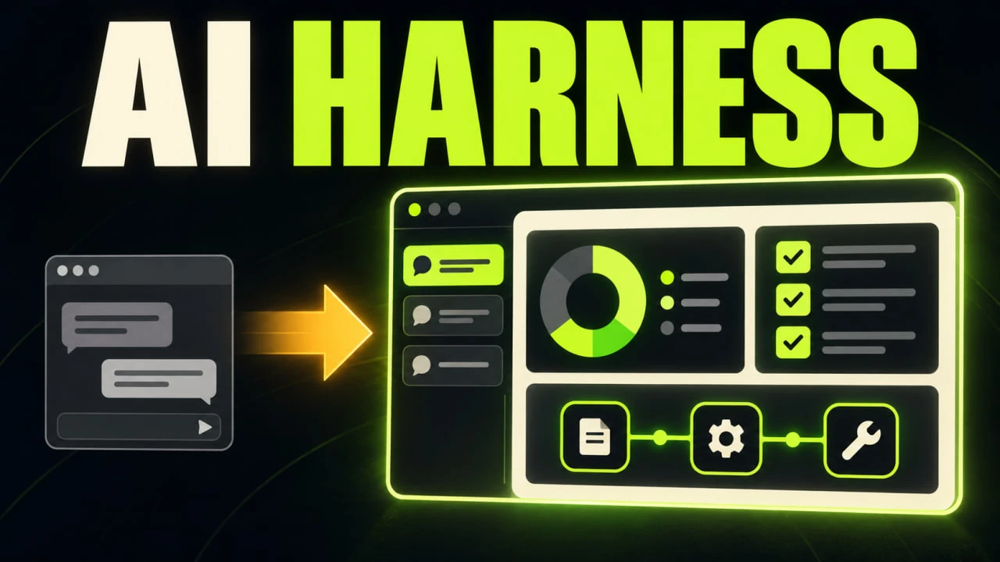

# Pax Harness

[English](docs/README.en.md)

Ваш игровой помощник в отдельном удобном чате: обсуждайте планы, изучайте экономику, сравнивайте данные и стройте диаграммы прямо в **Pax Universe**.

Harness использует ИИ из настроек игры. Вы выбираете модель и подключение привычным способом, а мод добавляет переписку, инструменты и наглядные ответы.

**Референсы:** скопируйте картинку и вставьте в поле сообщения через **Ctrl+V** или кнопку скрепки. В галерее генератора есть кнопка **«Использовать как референс»**. Можно приложить до двух изображений и написать текст рядом. В тонкой настройке выбранной модели включите **«Изображения на вход»**, если модель их поддерживает. При выключенной поддержке Harness предупредит об этом и отправит текст с уведомлением о недоступной картинке. Если API явно отклонит изображения, запрос автоматически повторится один раз без картинки; текст сохранится.

## Как открыть чат и настройки

1. Включите **Pax Harness** в разделе **Моды** и **загрузите или начните партию**.
2. Нажмите обычную игровую кнопку **«ВИ» (помощник)** — откроется чат Harness.
3. Для настроек мода откройте **меню игры → Настройки → вкладка «Харнес»**.

На вкладке «Харнес» меняются размер текста, отображение диалога, горячие клавиши, отправка во время ответа и статистика. Подключение модели и API находится отдельно: **Настройки → Нейросеть**.

Сообщения в очереди показаны компактной строкой с миниатюрой вложения. Справа можно отправить уточнение сразу или убрать его из очереди. В меню **«…»** — редактирование, перенос в новый чат и переключение режима очереди. Нажмите на строку, чтобы прочитать полный текст. Пока открыт редактор, сообщение не отправляется; перенос в новый чат сохраняет текст и картинки как черновик.

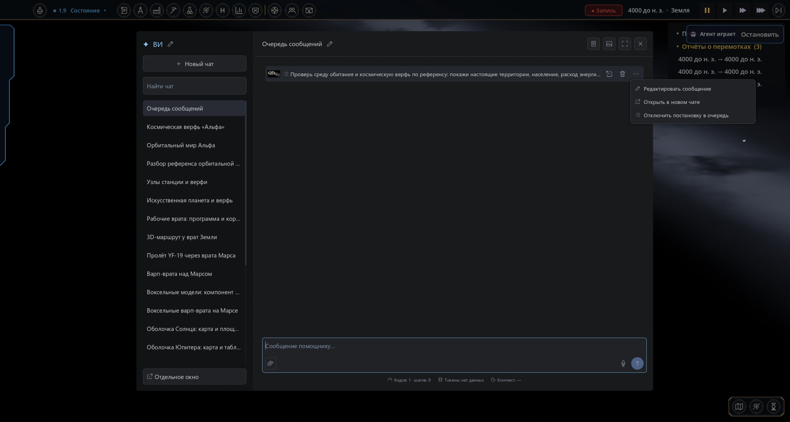

## Создание новых сущностей

По явному запросу помощник может подготовить воксельный объект с иконкой, новый ресурс, панель объекта, варп-маршрут или искусственную поверхность звезды/газового гиганта. Модель появляется прямо в сообщении: перетаскивайте её для вращения, используйте колесо для масштаба. Кнопки **«Применить»** и **«Отклонить»** находятся рядом. После применения нажмите **«Перейти к объекту»**: чат закроется, а космическая камера приблизится к самому объекту. Колесо меняет масштаб, обычное вращение камеры сохраняется. Каталог проектов открывается через **Настройки → Харнес → Открыть проекты новых сущностей**: поиск, фильтры, свёрнутые карточки и страницы по 10 записей. Только кнопка **«Применить»** в карточке добавляет изменение в текущую партию.

Обычные воксельные модели работают без дополнительного компонента. Для отдельно висящих разрушаемых объектов нужен **Voxel Tools**. В карточке применённого объекта включите **«Разрушение»** и нажмите на модель: удаляется участок настоящего объёма, повреждения сохраняются в партии. Агент также может подготовить отдельный проект повреждения по вашему запросу. Автоматического боя, обломков и анимации портала эта функция не добавляет.

Искусственная поверхность — отдельная твёрдая оболочка с собственной нативной картой и 4–40 территориями. Исходная звезда или газовый гигант сохраняется. После подтверждения попросите открыть карту поверхности соответствующего тела. Добавленные территории и объекты сохраняются с партией. Это авторское изменение сценария; население, колония, запасы и исследования автоматически не выдаются. Для обычного терраформирования за ресурсы используйте игровые приказы.

**Рабочая логика объектов:** помощник может написать программу вместе с моделью: переменные, условия, циклы, таймеры, смена дня, вход в область и пересечение плоскости. Программа читает игровые данные, перемещает реальные корабли и созданные объекты, меняет прочность корабля, запасы колонии или воксельный объём. Доступные действия зависят от установленных модов. Это общий набор операций: поведение врат, ремонтной станции или другого объекта составляет сам агент.

Можно создать и отдельный искусственный мир: своё небесное тело с моделью, орбитой и 4–40 нативными территориями. Его можно заселить обычным транспортом. Программа такого мира читает настоящее население и меняет его климатические параметры. Для производства кораблей при установленной «Сфере Дайсона» доступны чтение запасов, расход ресурсов и выпуск настоящего корабля. Очередь, стоимость, сроки и кнопки верфи пишет агент. Люди и запасы при создании мира автоматически не выдаются.

**Управление объектом:** помощник сам составляет раскладку и обработчики из общего набора: вложенные строки, колонки, сетки, вкладки, прокрутка, текст, показатели, таблицы, прогресс, поля ввода текста и чисел, ползунки, переключатели, выбор и кнопки. Нажмите **«Открыть управление»** в карточке объекта. Это элементы нативного интерфейса игры; произвольный код интерфейса не исполняется. Действия и проверки задаёт программа объекта. Введённые черновики сохраняются при смене языка, подтверждённое состояние — с партией.

Модель и программа применяются одной карточкой после вашего подтверждения. Показатели и кнопки программы находятся в этой же карточке. После применения события работают самостоятельно; состояние сохраняется с партией. Программу можно остановить, а её изменение требует нового подтверждения. При ошибке останавливается только эта программа; агент получает причину и место ошибки. Изменённые запасы и выполненные действия сохраняются.

Например: «Создай парящие врата и выход у другого тела. Напиши проверку заряда и размера корабля, перенос при входе, счётчик и кнопку пополнения». При установленной «Сфере Дайсона» программа может перенести тот же корабль к вычисленной точке выхода с сохранением груза и прочности. Отдельная функция связывания врат для этого не нужна. [Формат программ](docs/entity-programs.md).

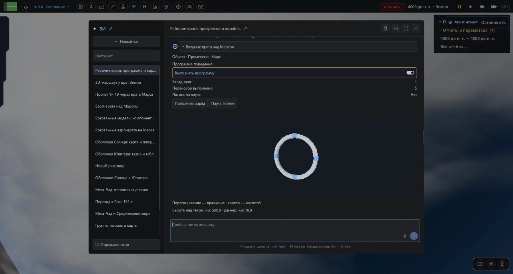

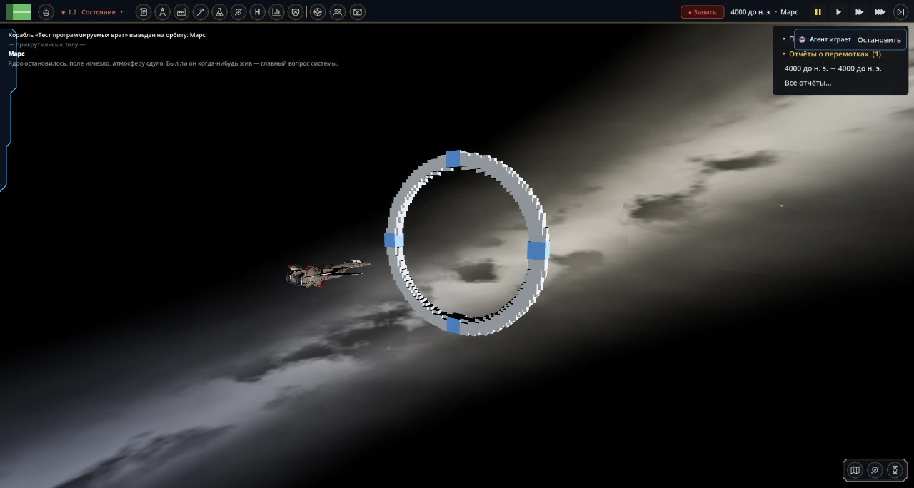

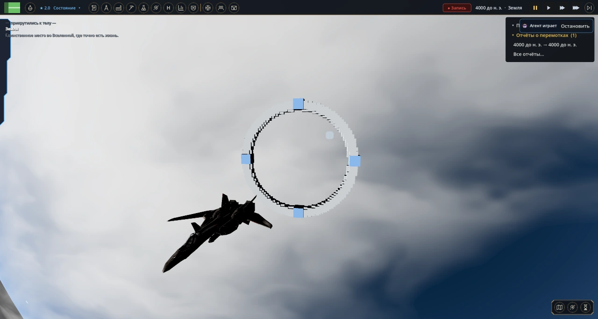

Для штатных транспортов с пассажирами также сохранён отдельный варп-маршрут: он меняет расписанное прибытие после подтверждения игроком. Это другой способ работы с транспортом; новые вселенные он не создаёт.

Список всех инструментов с короткими описаниями находится в раскрывающихся группах **Настройки → Харнес → Инструменты агента**. У каждой группы и функции есть галочка: квадрат показывает частично включённую группу. Отключённые функции не передаются модели и не выполняются, даже если ответ уже начат. Выбор сохраняется между партиями. Ресурсы используют обычные игровые строки; цвет текста можно изменить отдельным подтверждаемым проектом по вашему запросу.

Предпросмотр разрушаемого объекта прямо в сообщении (после теста повреждений):

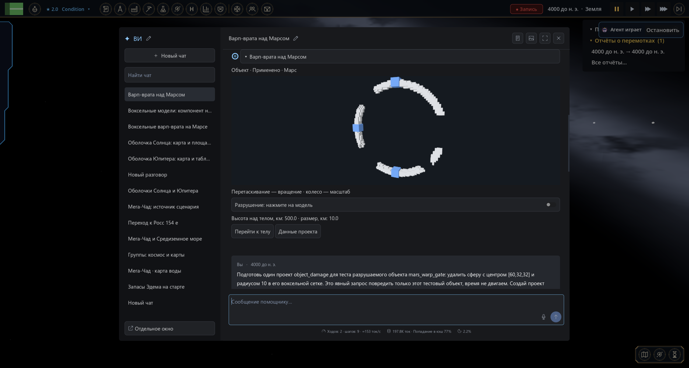

Каталог со свёрнутыми карточками, поиском и страницами:

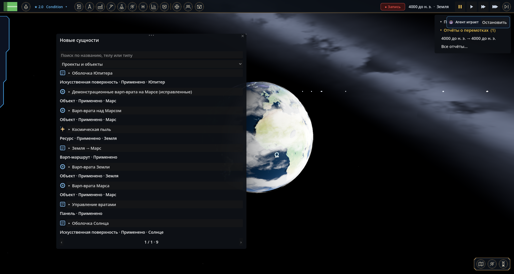

## Что умеет

**Инструменты по запросу:** сначала помощник получает короткий каталог групп. Полные описания графиков, карт, интерфейса, космоса и других инструментов загружаются только по мере необходимости. Наборы данных модов и схемы конкретных диаграмм также читаются отдельно, когда нужны для ответа.

**География:** попросите показать море, озеро или участок побережья вместе с сушей. Harness читает маску воды текущей партии, включая изменения сценариев и модов. В небольшом окне сохраняются отдельные провинции, в широком обзоре суша может объединяться в фоновый слой. На других телах карта должна быть уже открыта в игре. Именованные объекты моды могут передавать через общий API источников; сами контуры остаются локально, в контекст модели попадает краткое описание и ссылка для показа.

**Космос:** можно искать тела и звёзды в игровом каталоге, узнавать правила орбитальных проектов и терраформирования, открывать систему и направлять камеру к конкретному телу. Например: «Перенеси камеру к Росс 154 e». Сначала проверяются действительные названия: если такой планеты в созданной игрой системе нет, помощник сообщит об этом. Перенос камеры не перемещает жителей и не создаёт колонию.

Свои параметры находятся на вкладке **Настройки → Харнес**: размер текста диалога, отображение шагов, технические подробности, горячие клавиши, отправка во время ответа, статистика и workflow изображений. Настройки сохраняются сразу. Ширина списка регулируется перетаскиванием, имя агента — рядом с его именем в чате. Настройки API и модели остаются в штатной тонкой настройке игры.

- Несколько чатов, разделы, закрепление и поиск. Названия можно менять, а ширину списка — подстроить мышью.
- Ответы появляются постепенно. Вызовы инструментов можно раскрыть и посмотреть, откуда взялись данные.
- Таблицы с поиском, сортировкой, страницами и выгрузкой в CSV.
- Открытие игровых панелей по просьбе: ресурсы, производство, наука, настройки и другие доступные окна.
- Создание иллюстраций через настроенный в игре генератор изображений с показом результата прямо в чате.
- Снимок игрового окна для модели с поддержкой изображений: включается отдельно в «Тонкой настройке ИИ».
- 39 видов графиков и диаграмм, карты провинций и графики математических функций.
- Постоянные инструкции для одного чата или всей партии, план задачи с отметками прогресса.
- Ссылки на другие чаты через `@` и перетаскивание. По вашей просьбе помощник может прочитать связанный чат.
- Переписка, черновики и настройки чатов сохраняются с партией. Длинные разговоры можно продолжать благодаря сжатию истории.
- Данные совместимых модов: например, предприятия Pax Corporations, экономика и Сфера Дайсона. Доступные сведения зависят от установленных и включённых модов.

## Установка

Версия мода: **1.19.0**. Проверенная версия игры: **0.31.5**.

### Через официальную мастерскую

1. В лаунчере откройте **Мастерская**, найдите **Pax Harness** и нажмите **«Установить»**.
2. В разделе **Моды** убедитесь, что Pax Harness включён.

### Вручную из GitHub

1. Скачайте `pax_harness-1.19.0.zip` из раздела **Releases** и закройте игру.
2. Откройте **Лаунчер → Моды → Папка модов** и поместите туда ZIP целиком. Распаковывать архив не нужно. На Windows пользовательская папка обычно находится в `%APPDATA%\Pax Universe\mods`.
3. Запустите игру и включите Pax Harness в разделе **Моды**.

Если игра попросит разрешить выполнение кода мода, подтвердите его штатным способом. Подключите разговорную модель в настройках игры, загрузите или начните партию и откройте **ВИ** обычной игровой кнопкой.

Не устанавливайте одновременно архив и распакованную копию одного мода. При ручном обновлении замените старый архив или папку при закрытой игре. Установка из мастерской обновляется через лаунчер. Чаты хранятся в сохранении партии, а не в архиве мода.

## С чего начать

Напишите обычную задачу. Не нужно выбирать диаграмму вручную или составлять запрос на специальном языке.

> Сравни производство и потребление еды. Покажи дефицит и объясни, что ограничивает рост.

> Найди последние десять проваленных планов и сгруппируй причины.

> Сравни предприятия по отраслям: количество, выручка и прибыль. Покажи таблицу и диаграмму.

> Построй график запасов стройматериалов по сохранённой истории. Отдельно отметь, где данных не хватает.

> Покажи на карте провинции с наибольшим числом предприятий.

> Составь план развития энергетики. Сначала только анализ, без изменений в игре.

Для расчётного примера можно попросить: «Покажи, как будет меняться спрос при ежегодном росте на 5 %» или «Нарисуй параболу и синусоиду». Такой расчёт помечается отдельно от наблюдаемых игровых данных.

## Графики и таблицы

| Для чего | Что можно показать |
| --- | --- |
| Сравнение | Горизонтальные и вертикальные столбцы, составные столбцы, водопад, парные сравнения dumbbell |
| Изменения во времени | Линии, площади и составные площади, столбцы вместе с линией, slope и bump |
| Доли и иерархии | Круговая и кольцевая диаграммы, treemap, sunburst, дерево, icicle |
| Связи показателей | Точки, пузырьки, радар, параллельные координаты, набор небольших графиков |
| Распределения | Гистограмма, box plot, плотность, violin и ridgeline |
| Матрицы и интервалы | Тепловая и календарная карты, интервальные полосы, границы значений error bar |
| География | Хороплет, схематичная картограмма, символы на карте и карта потоков |
| Потоки и проекты | Санки, сеть связей и диаграмма Ганта |

Наведите мышь на точку, область или поток, чтобы увидеть подробности. У диаграмм есть масштабирование, фильтры и повтор анимации. В Санки и сетях можно подсветить связанные потоки; в sunburst — раскрывать ветви. Таблицы позволяют находить строки, сортировать столбцы и сохранять CSV.

Помощник использует доступные источники и сохранённую историю. Сведения, которых нет в партии, не возникают задним числом: попросите указать период и охват, если сравнение должно быть точным. Для модов доступность конкретной карты или показателя зависит от того, какие данные предоставляет сам мод.

## Экран, панели и изображения

Попросите: «Открой ресурсы», «Открой настройки нейросети» или «Посмотри на игровой экран». Помощник выбирает из доступных игровых окон. Снимки доступны, когда для выбранного адреса API и модели включены **«Использовать профиль»** и **«Изображения на вход»** в дополнительном моде «Тонкая настройка ИИ». Нужна модель, которая действительно принимает изображения. Снимается игровое окно; чат временно скрывается. Снимок передаётся следующему запросу и не записывается в сохранение.

Для иллюстраций настройте **Настройки → Нейросеть → Генерация фото**, затем попросите: «Сгенерируй иллюстрацию нашей будущей столицы». Генератор изображений работает отдельно от разговорной модели. Готовая картинка появляется в чате и сохраняется модом. Если подключение не настроено, помощник сообщит об этом.

Значок изображения в заголовке чата открывает параметры генерации. Обычно используется штатный генератор игры. Для ComfyUI можно вставить свой **API JSON workflow**, выбрать поле положительного описания и включить его. Адрес ComfyUI берётся из подключения игры. Harness меняет только выбранное поле описания; модели, размеры, seed и референсы задаются самим workflow. «Штатный генератор» отключает это переопределение.

## Инструкции и организация чатов

Значок инструкций находится справа вверху окна. Во вкладке **«Этот чат»** задайте пожелания для текущего разговора, во вкладке **«Вся партия»** — общие правила. Например:

> Отвечай по-русски и кратко. Всегда указывай единицы и дату данных. Перед изменением политики сначала объясни последствия.

Карандаш возле названия меняет имя чата, карандаш возле «ВИ» — имя помощника. Другие действия с чатом открываются правой кнопкой мыши. Чтобы связать разговоры, введите `@` в сообщении или перетащите чат из списка.

Если разговор стал длинным, можно отправить `/compact`. Сводка раскрывается в переписке; полный разговор остаётся в архиве. Сохранённый план можно продолжить просьбой «Продолжи план».

## Модели и совместимость

Модель выбирается **в настройках Pax Universe**. У Harness нет собственного списка аккаунтов и обязательного провайдера. Для работы нужна разговорная модель с API, поддерживаемым игрой. Качество рассуждений, скорость и способность пользоваться инструментами зависят от выбранной модели.

**Pax Prompt Lab необязателен.** Если он установлен, выбранные в лаборатории промпты и наборы инструментов могут использоваться в чатах Harness. Дополнительный мод **«Тонкая настройка ИИ»** позволяет настроить профиль подключённой модели.

Некоторые игровые моды отключают ИИ целиком. Например, у «Переработки экономики» есть собственная настройка доступности ИИ: если чат сообщает об отключении, проверьте её в настройках этого мода.

## Сохранения

Чаты, разделы, черновики, ссылки, инструкции и планы привязаны к партии. После загрузки можно продолжить разговор с того места, где остановились. Прерванный при выходе запрос не выполняется повторно сам по себе.

Помощник может использовать игровые инструменты, поэтому уточняйте желаемый режим: «только проанализируй», «предложи варианты» или «выполни». Сохранение перед крупными изменениями поможет сравнить результат с прежним состоянием партии.

## Галерея

Ниже — интерфейс в самой игре. Демонстрационные диаграмма и таблица используют учебные данные. Карты, новые сущности и настройки показаны на отдельной тестовой партии.

**Производство и потребление на общей диаграмме**

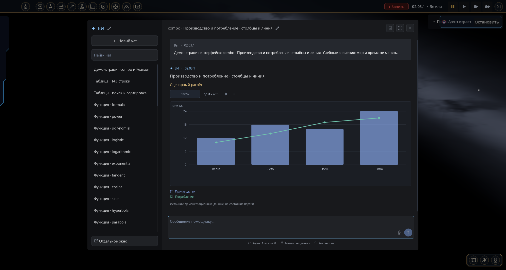

**Искусственная поверхность с нативными территориями**

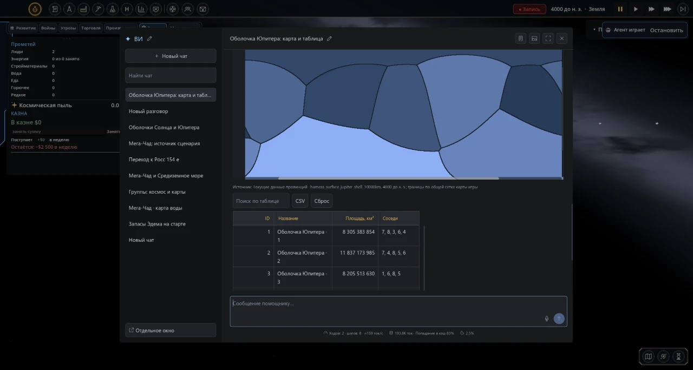

**Поиск по большой таблице**

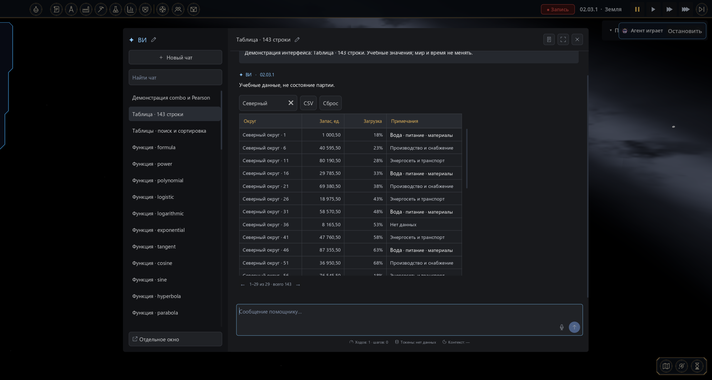

**Иллюстрация через подключённый генератор**

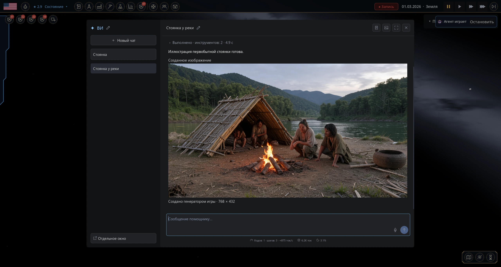

Изображение создано FLUX в подключённом ComfyUI. Это иллюстрация, а не наблюдение состояния партии.

## Авторы и лицензии

**Jemov** — Pax Harness и его развитие для Pax Universe.

В моде использованы адаптированные компоненты **Pax Prompt Lab**, автор **IliaOknesavi**: [исходный проект](https://github.com/IliaOknesavi/pax-prompt-lab-laboratoriya-promptov).

Визуальный и архитектурный референс — **DeepSeek Harness**: [исходный проект](https://github.com/deepseek-ai/deepseek-harness). Его лицензия MIT сохранена в [HARNESS_LICENSE.txt](HARNESS_LICENSE.txt). Авторские уведомления исходных компонентов сохранены в файлах мода.

## Структура проекта

- `src/chat` — переписка, история и сжатие контекста.
- `src/runtime` — выполнение задач и зарегистрированные инструменты.
- `src/transport` — подключение моделей и передача ответов и изображений.
- `src/visualization` — схемы, отображение, карты и управление диаграммами.
- `src/data` — игровые данные и адаптеры модов.
- `src/creation` — модели, проекты, программы сущностей и адаптер движения кораблей.
- `src/images` — генерация и хранение иллюстраций.
- `src/ui` — окно чата, таблицы, диалоги и снимки игрового экрана.
- `src/core` — совместимость, диагностика и восстановление состояния.
- `prompts`, `config` — инструкции и начальные параметры.
- `docs`, `media` — документация и изображения страницы проекта.

В установочном архиве нет рекламной галереи. Точка входа мода — `src/main.gd`.

## Настройки Harness

Размер текста, отображение шагов, технические подробности, горячие клавиши, отправка во время ответа, статистика и workflow изображений доступны на вкладке **Настройки → Харнес**.

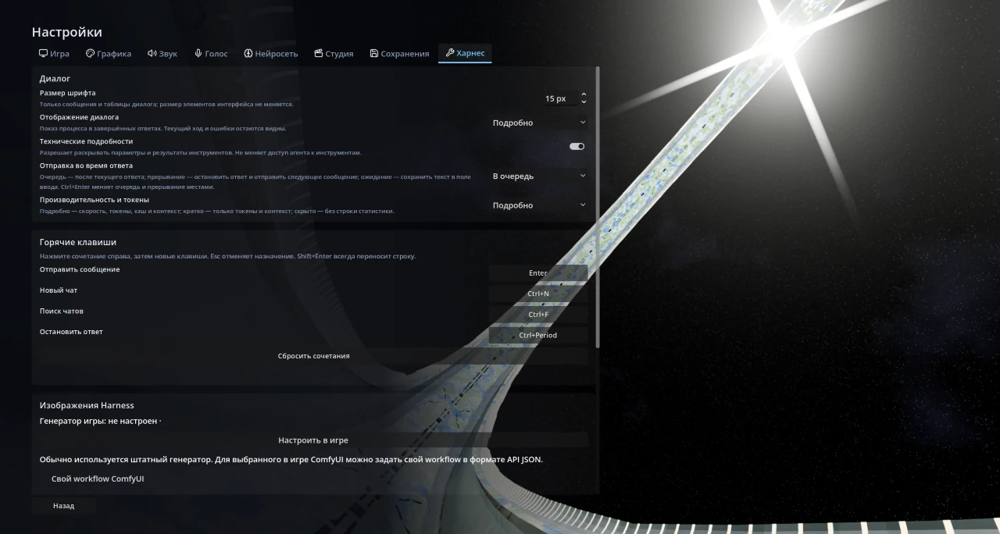

## Языки / Languages

Русский и английский. Язык интерфейса мода следует языку игры и меняется вместе с ним; отдельного переключателя нет. Для других языков игры используется английский. Текст переписки, пользовательские названия и введённые данные не переводятся.

Russian and English. The mod follows the game language, including open windows. There is no separate language switch. Conversation text, custom names and entered data remain unchanged.

**Маршруты кораблей в 3D:** при установленной «Сфере Дайсона» помощник может подготовить местный маршрут настоящего корабля относительно созданного объекта: подлёт, облёт или проход через кольцо. Он выбирает модель, размер, ориентацию носа и точки пути. Подтвердите карточку, затем используйте «Повторить пролёт». Маршрут сохраняется в партии; обычная новая команда кораблю возвращает штатное управление. Сам маршрут задаёт движение. Реакцию объекта на пролёт, перенос, расход заряда или изменение прочности определяет отдельная программа агента; автоматического расчёта физических столкновений нет.
